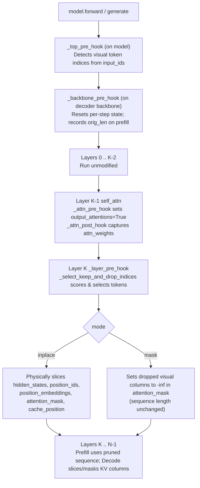

# `fastv_hf.py` — Function & Class Reference

Reference documentation for every class, method, and function in [`src/FastV/fastv_hf.py`](./fastv_hf.py).

`fastv_hf.py` implements **FastV** (*"An Image is Worth 1/2 Tokens After Layer 2"*, Chen et al., ECCV 2024 Oral) using pure PyTorch forward hooks so it runs directly on upstream HuggingFace `transformers` (`>=4.45` through `5.x`) without modifying or vendoring `transformers`. It delegates architecture-specific details to [`adapters.py`](./adapters.py) and visual-token importance scoring to [`scoring.py`](./scoring.py).

---

## Architecture & Hook Execution Flow

---

## Module Constants

| Constant | Lines | Description |
|---|---|---|
| `VICUNA_SYSTEM_PROMPT` | L36–39 | Standard Vicuna/LLaVA-1.5 system prompt prepended when `include_system_prompt=True`. |
| `DEFAULT_HF_MODEL_7B` | L41 | Default 7B checkpoint ID: `"llava-hf/llava-1.5-7b-hf"`. |
| `DEFAULT_HF_MODEL_13B` | L42 | Default 13B checkpoint ID: `"llava-hf/llava-1.5-13b-hf"`. |

---

## 1. Configuration (`FastVConfig`)

### `class FastVConfig` (L45–120)
Dataclass holding all FastV pruning hyperparameters:
- `use_fastv: bool = True` — Master switch enabling/disabling pruning.
- `fastv_k: int = 2` — Pruning layer index `K` (`0` = random pruning before layer 0; `K > 0` = prune before layer `K` using attention from layer `K - 1`).
- `fastv_r: float = 0.5` — Fraction of visual tokens to drop (`0.0` to `1.0`).
- `mode: str = "inplace"` — `"inplace"` (physically drops tokens for real speedup/memory savings) or `"mask"` (masks dropped visual tokens in attention without changing sequence length, used for paper Figure 7 ablations).
- `scorer: str | ScorerFn = "fastv_mean"` — Scorer name from `scoring.SCORERS` or custom callable.
- `scorer_kwargs: dict` — Extra keyword arguments forwarded to the scorer (e.g., `alpha`, `query_index`).
- `image_token_start_index: Optional[int]` / `image_token_length: Optional[int]` — Optional manual override for the visual token span; when `None`, detected automatically from `input_ids`.
- `attention_rank: Optional[int]` — Optional explicit count of visual tokens to keep (overrides `fastv_r`).
- `random_seed: int = 42` — Seed for random pruning when `fastv_k == 0` (or if attention weights are unavailable).
- `force_slice_at_r0: bool = False` — Forces the full slicing path even when `keep_n == N_vis` (used by `R=0` parity tests).

#### `FastVConfig.__post_init__(self) -> None` (L61–71)
Validates `mode`, `fastv_k >= 0`, `0.0 <= fastv_r <= 1.0`, `attention_rank >= 0`, and eagerly validates `scorer` via `resolve_scorer(self.scorer)` so invalid scorer names fail immediately.

#### `FastVConfig.from_any(cls, cfg) -> FastVConfig` (L73–101)
Normalizes flexible input configs into a `FastVConfig` instance:
- `None` → `FastVConfig(use_fastv=False)`
- `FastVConfig` → returned as-is
- `dict` → maps legacy config aliases (`use_fast_v`, `enabled`, `fast_v_agg_layer`, `agg_layer`, `prune_ratio`, `fast_v_sys_length`, `fast_v_image_token_length`, `fast_v_attention_rank`, and `fast_v_inplace` → `mode`), filters unknown keys, and constructs `FastVConfig`.

#### `FastVConfig.resolve_keep_count(self, image_token_length: int) -> int` (L103–108)
Computes the exact number of visual tokens to keep out of `image_token_length`. Uses `attention_rank` if explicitly set; otherwise computes `round(image_token_length * (1 - fastv_r))`, clamped to `[0, image_token_length]`.

#### `FastVConfig.effective_pruning_ratio(self, image_token_length: int = 576) -> float` (L110–114)
Returns the actual pruning fraction `1 - keep / image_token_length` after integer rounding (or `0.0` if FastV is disabled or `image_token_length <= 0`).

#### `FastVConfig.to_dict(self) -> Dict[str, Any]` (L116–120)
Serializes the dataclass to a JSON-friendly dictionary, replacing callable `scorer` objects with their `__name__` (or `repr`).

---

## 2. Theoretical FLOPs & Visual Token Detection

### `compute_fastv_flops_ratio(...) -> Dict[str, float]` (L123–164)
Computes theoretical prefill FLOPs and FLOPs reduction following Equations 1–2 of the FastV paper (Section 3.3).
- **Parameters**: `num_layers`, `fastv_k`, `fastv_r`, `n_image_tokens=576`, `n_text_tokens=60`, `hidden_size=4096`, `intermediate_size=11008`, `swiglu=False`.
- **Inner helper `_layer_flops(n)` (L143–148)**: Computes per-layer FLOPs `4*n*d^2 + 2*n^2*d + ffn_mult*n*d*m` (`ffn_mult = 3.0` if `swiglu=True`, else `2.0`).
- **Formula**:
  - `baseline_flops = T * _layer_flops(n_full)`
  - `fastv_flops = K * _layer_flops(n_full) + (T - K) * _layer_flops(n_kept)`
- **Returns**: Dict with `baseline_tflops`, `fastv_tflops`, `flops_ratio`, `flops_ratio_pct`, `flops_reduction`, `flops_reduction_pct`, `tokens_before`, and `tokens_after`.

### `detect_visual_token_indices(input_ids, visual_token_ids=32000, default_image_length=576) -> Optional[List[int]]` (L167–204)
Scans the first batch item of `input_ids` (PyTorch tensor, NumPy-like array, or Python list) and returns the sorted list of all positions matching `visual_token_ids` (int or sequence of ints).
- Supports **modern `transformers >= 4.45`** (LLaVA and Qwen2-VL), where visual tokens are already expanded in `input_ids` (including non-contiguous multi-image or image+video prompts).
- Supports **older `transformers < 4.45`**: if only a single placeholder token is found and `default_image_length > 1`, expands it to `[start, ..., start + default_image_length - 1]`.
- Returns `None` if no visual tokens are found.

### `detect_image_token_span(input_ids, image_token_index=32000, default_image_length=576) -> Optional[Tuple[int, int]]` (L207–220)
Backwards-compatible wrapper around `detect_visual_token_indices` returning `(start_index, total_visual_token_count)` for single-image prompts, or `None` if no image tokens are detected.

---

## 3. Model Resolution & Internal Attention / Mask Helpers

### `resolve_hf_model_id(model_path=None, requested_size=None, gpu_memory_gib=None) -> str` (L223–251)
Resolves a local path, HuggingFace Hub ID, legacy model name, or hardware budget into a loadable model identifier:
1. If `model_path` exists on disk or looks like a HF repo ID (`org/name`), returns it directly.
2. If `model_path` contains `"13b"` or `"7b"`, maps to `DEFAULT_HF_MODEL_13B` or `DEFAULT_HF_MODEL_7B`.
3. Otherwise checks `requested_size` (or env var `FASTV_MODEL_SIZE`).
4. Falls back to GPU VRAM auto-selection: `>= 24.0 GiB` → 13B, else 7B.

### `get_llama_backbone(model) -> Any` (L254–256)
Convenience wrapper that resolves the model's adapter via `resolve_adapter(model)` and returns its transformer decoder backbone exposing `.layers`.

### `_set_eager_attention(model, backbone) -> None` (L259–280)
Forces the model and decoder layers to use `"eager"` attention (instead of SDPA or FlashAttention-2) so layer `K - 1` materializes full attention weights when `output_attentions=True`. Tries `model.set_attn_implementation("eager")` first and falls back to setting `_attn_implementation = "eager"` on `model.config`, `backbone.config`, `text_config`, and each layer's `self_attn.config`.

### `_make_causal_additive_mask(seq_len, kv_len, dtype, device, batch_size=1)` (L283–297)
Builds a 4D causal additive attention mask of shape `(batch_size, 1, seq_len, kv_len)` with `0` for allowed positions and `torch.finfo(dtype).min` for masked future positions. When `seq_len == 1` (single-token decode), returns all zeros. Used in `mode="mask"` when the model didn't pass an explicit 4D `attention_mask`.

---

## 4. Hook Engine (`FastVController`)

### `class FastVController` (L300–717)
Architecture-agnostic PyTorch hook controller that intercepts forward passes on any supported HuggingFace VLM/LLM to capture layer `K - 1` attention and prune/mask visual tokens from layer `K` onward.

#### `FastVController.__init__(self, model, config=None, adapter=None)` (L303–322)
Resolves the `BaseVLMAdapter` and decoder `backbone`, normalizes `config` via `FastVConfig.from_any`, queries visual token IDs and default image length from the adapter, initializes transient state, installs all forward hooks (`_install_hooks`), and ensures eager attention is enabled whenever `use_fastv=True` and `fastv_k > 0`.

#### `FastVController._reset_generation_state(self) -> None` (L324–333)
Clears all cached per-generation and per-step state (`_detected_vis_indices`, `_last_prefill_*`, `_step_*`, and `last_stats`).

#### `FastVController.update_config(self, config) -> FastVController` (L335–340)
Hot-swaps the active `FastVConfig` on an already-loaded model, resets cached state, and enforces eager attention if `use_fastv and fastv_k > 0`. Allows running multiple `(K, R, mode)` experiments without reloading model weights.

#### `FastVController.disable(self) -> None` (L342–344)
Sets `self.config = FastVConfig(use_fastv=False)` and resets state, restoring vanilla decoding while keeping hooks installed for fast re-enabling.

#### `FastVController.remove(self) -> None` (L346–353)
Calls `.remove()` on every registered PyTorch hook handle, clears `self._handles`, and resets all internal state.

#### `FastVController._resolve_vis_indices(self, seq_len, device) -> Optional[Tensor]` (L355–372)
Returns a 1D `torch.long` tensor of visual token positions within `[0, seq_len)`:
- Uses manual `config.image_token_start_index` + `image_token_length` (or `default_image_length`) if explicitly configured.
- Otherwise uses `self._detected_vis_indices` captured by `_top_pre_hook` (filtered to `< seq_len` and optionally truncated to `image_token_length`).

#### `FastVController._select_keep_and_drop_indices(self, seq_len, device, attn_weights) -> Optional[Tuple[Tensor, Tensor]]` (L374–432)
Core token-selection algorithm executed at layer `K` during prefill:
1. Resolves visual token positions via `_resolve_vis_indices` and computes `keep_n = config.resolve_keep_count(n_vis)`.
2. Short-circuits (`return None`) if `keep_n >= n_vis` and `not force_slice_at_r0`.
3. Selects which visual tokens survive:
   - `keep_n >= n_vis` → keeps all visual tokens.
   - `fastv_k == 0` or `attn_weights is None` → deterministic random subset seeded by `config.random_seed`.
   - Otherwise → resolves `scorer_fn = resolve_scorer(config.scorer)`, scores each visual token using `attn_weights`, and picks `scores.topk(keep_n)`.
4. Combines all non-visual token indices with `kept_vis_indices`, sorts them to preserve original sequence order (`keep_indices`), and computes the complement (`drop_indices`).
5. Records telemetry in `self.last_stats` (adapter, scorer, mode, `K`, effective `R`, kept/dropped counts, original vs. pruned sequence length).
6. Returns `(keep_indices, drop_indices)`.

#### `FastVController._slice_attention_mask_prefill(self, attn_mask, keep_indices, orig_len)` (L434–453)
Slices `attention_mask` during **inplace prefill** to match the pruned sequence length:
- Recursively handles `dict` masks (e.g., `transformers >= 4.53` mapping `{"full_attention": ..., "sliding_attention": ...}`).
- For 4D masks `(B, 1, Q, KV)`: indexes both query (`dim=-2`) and key (`dim=-1`) axes where they equal `orig_len`.
- For 2D masks `(B, S)`: indexes `dim=-1`.

#### `FastVController._slice_attention_mask_decode(self, attn_mask)` (L455–469)
Slices `attention_mask` during **inplace KV-cached decoding** (`cur_seq_len == 1`). Because layers `< K` cache all `orig_len` prompt keys while layers `>= K` only cache `keep_indices` plus newly generated tokens (`orig_len .. kv_len - 1`), this selects `[keep_idx, orig_len..kv_len)` along the key axis (`dim=-1`) so layers `>= K` receive the exact mask width matching their pruned KV cache. Also handles `dict` masks recursively.

#### `FastVController._apply_token_mask(self, attn_mask, drop_indices, q_len, kv_len, dtype, device, batch_size)` (L471–499)
Implements **`mode="mask"`** (ablation mode without physical token dropping):
- Recursively handles `dict` masks.
- Creates a fresh 4D causal mask via `_make_causal_additive_mask` if `attn_mask is None`, otherwise clones `attn_mask`.
- Sets columns corresponding to `drop_indices` to `torch.finfo(mask.dtype).min` (for 4D additive masks) or `0` (for 2D binary masks).

#### `FastVController._install_hooks(self) -> None` (L501–717)
Registers all PyTorch forward hooks on `self.model`, `self.backbone`, and each decoder layer, defining five nested hook callbacks:

1. **`_top_pre_hook` (L503–517)** — Registered on `self.model` (`with_kwargs=True`). On prefill (`input_ids.shape[-1] > 1`), calls `detect_visual_token_indices` and caches `self._detected_vis_indices`.
2. **`_backbone_pre_hook` (L522–542)** — Registered on `self.backbone` (`with_kwargs=True`). Resets per-step state (`_step_*`) at the start of every backbone forward pass; when `seq_len > 1` (prefill), records `_step_orig_len` and clears previous prefill cache indices.
3. **`_make_attn_pre_hook` / `_attn_pre_hook` (L553–568)** — Registered on each layer's `self_attn` (`with_kwargs=True`). Only at layer `idx == fastv_k - 1` during prefill, injects `output_attentions=True` into kwargs (if `self_attn.forward` accepts it).
4. **`_make_attn_post_hook` / `_attn_post_hook` (L570–582)** — Registered on each layer's `self_attn`. Only at layer `idx == fastv_k - 1` during prefill, captures `output[1].detach()` into `self._step_captured_attn`.
5. **`_make_layer_pre_hook` / `_layer_pre_hook` (L592–713)** — Registered on every `decoder_layer` (`with_kwargs=True`). For layers `idx >= K`:
   - **Prefill path (`_step_orig_len > 1`)**:
     - At `idx == K`: calls `_select_keep_and_drop_indices` and stores `keep_indices` / `drop_indices` for layers `K .. N-1` and subsequent decode steps.
     - In `mode="inplace"`: slices `hidden_states` at layer `K` along `dim=1`, delegates `position_ids` and RoPE `position_embeddings` slicing to `self.adapter`, slices `attention_mask` via `_slice_attention_mask_prefill`, and trims `cache_position` to `[:new_seq_len]`.
     - In `mode="mask"`: applies `_apply_token_mask` to `attention_mask` without altering sequence length.
   - **Decode path (`cur_seq_len == 1` with KV cache)**:
     - In `mode="inplace"`: slices `attention_mask` via `_slice_attention_mask_decode` so mask columns match the pruned KV cache length.
     - In `mode="mask"`: determines `kv_len` (from `attention_mask` or `past_key_values.get_seq_length(idx) + 1`) and masks `self._last_prefill_drop_indices` via `_apply_token_mask`.

---

## 5. Controller Lifecycle Public API

### `attach_fastv(model, fastv_config=None, adapter=None) -> FastVController` (L720–734)
Attaches a `FastVController` to `model` (stored at `model._fastv_controller`) and returns it. If a controller is already attached and no new `adapter` is provided, updates its config in place; if a new `adapter` is provided, cleanly removes the old controller first.

### `set_fastv_config(model, fastv_config) -> FastVController` (L737–742)
Convenience alias for `attach_fastv(model, fastv_config)`.

### `disable_fastv(model) -> None` (L745–749)
Disables FastV pruning on `model` (switches back to vanilla decoding) if a `FastVController` is attached.

### `remove_fastv(model) -> None` (L752–757)
Detaches all PyTorch hooks from `model` and deletes `model._fastv_controller`.

---

## 6. Model Loading & Input Preparation (Handler Re-exports & LLaVA Wrappers)

The model-family loading, prompt formatting, and input preparation implementations live in [`handlers.py`](./handlers.py) (`BaseVLMHandler`, `LlavaHandler`, `Qwen2VLHandler`). `fastv_hf.py` directly re-exports `BaseVLMHandler`, `LlavaHandler`, `Qwen2VLHandler`, `resolve_handler`, `load_vlm_model`, `format_vlm_prompt`, and `prepare_vlm_inputs` from `.handlers` so callers can import them from `FastV.fastv_hf` alongside `FastVConfig`.

The three legacy LLaVA functions remain as thin backwards-compatible wrappers delegating to `LlavaHandler`:

### `load_llava_model(model_id=None, quantization="4bit", dtype=None, attn_implementation="eager", fastv_config=None, device_map="auto", revision=None) -> Tuple[model, processor, controller]`
Delegates to `LlavaHandler().load_model(...)` in [`handlers.py`](./handlers.py), loading HuggingFace `LlavaForConditionalGeneration` + `AutoProcessor` (with 4-bit/8-bit/fp16 support and `transformers >= 4.56` `dtype` fallback) and attaching `FastVController`.

### `format_llava_prompt(prompt, include_system_prompt=False, append_output="") -> str`
Delegates to `LlavaHandler().format_prompt(...)`, formatting a raw user prompt into LLaVA-1.5 conversation format (`[VICUNA_SYSTEM_PROMPT ]USER: <image>\n{prompt}\nASSISTANT:{append_output}`).

### `prepare_llava_inputs(processor, prompt, image, device, dtype, include_system_prompt=False, append_output="", image_token_index=32000) -> Tuple[Dict[str, Any], Optional[Tuple[int, int]]]`
Delegates to `LlavaHandler().prepare_inputs(...)`, formatting the prompt, converting `image` to RGB, running `processor(...)`, moving tensors to `(device, dtype)`, and returning `(inputs_dict, image_span)`.

---

## 7. Analysis & Evaluation Metrics

### `compute_layer_attention_efficiency(attentions, image_start, image_length, instruction_end=None) -> Dict[str, List[float]]` (L876–938)
Reproduces the per-layer visual attention analysis from Paper Section 2 / Figure 3. For each layer's attention tensor `(B, H, Q, KV)`:
- Averages across heads (`dim=1`) for batch item `0`.
- Aggregates query rows over generated output tokens (`inst_end:`) if `instruction_end < seq_len`, otherwise uses the last prompt token (`-1`).
- Splits attention mass into four regions: **system** (`[:image_start]`), **image** (`[image_start:img_end]`), **text/instruction** (`[img_end:inst_end]`), and **output** (`[inst_end:]`).
- Computes total attention share, per-token average attention for each region, and **Visual Attention Efficiency** (`image_total / (n_image_tokens / seq_len)`).

### `_lcs_length(a: Sequence[str], b: Sequence[str]) -> int` (L941–953)
Space-optimized `O(len(b))` dynamic programming helper computing the Longest Common Subsequence length between two token lists. Used by `compute_rouge_l`.

### `compute_rouge_l(references, predictions, beta=1.2) -> Tuple[float, List[float]]` (L956–984)
Pure-Python implementation of ROUGE-L matching `pycocoevalcap.rouge.rouge.Rouge` (with `beta=1.2`), removing the need for external Java/C evaluation dependencies. For each prediction against its list of reference strings, finds the reference maximizing recall (breaking ties by precision), computes `F_beta = ((1 + beta^2) * P * R) / (R + beta^2 * P)`, and returns `(average_score, per_sample_scores)`.
